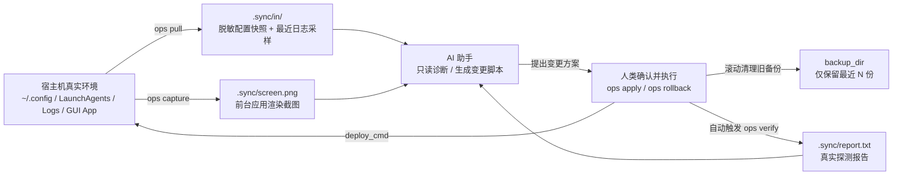

# `ops` — Mac 轻量级人机协同运维 CLI

`ops` 是一套专为 macOS 设计的单文件 Bash 运维协同工具（兼容 macOS 自带 Bash 3.2 与 `openrsync`，免 root 安装到 `~/.local/bin/ops`）。它由每个项目根目录的 `.ops.json` 驱动，把宿主机隐藏配置、最近日志、真实探测输出与桌面应用截图统一归口到 `.sync/` 目录，让**人类负责执行宿主机变更、AI 负责只读分析与出方案**，全程可控、零堆积。

---

## 1. 人机协同工作流程图



ASCII 简版（方便纯文本终端或 AI 快速扫描）：

```text
  [宿主机配置/日志/App]
     │            ▲
     │ ops pull   │ ops apply (deploy_cmd -> 清理旧备份 -> ops verify)
     │ ops capture│ ops rollback (rollback_cmd -> ops verify)
     ▼            │
  [.sync/] ──► [AI 读取 in/、report.txt、screen.png 诊断并修改项目文件] ──► [人类复核执行]
```

---

## 2. 安装与依赖

### 依赖要求
- **Bash**：macOS 自带 `/bin/bash`（3.2+ 即可，无需额外升级）。
- **`jq`**：用于解析 `.ops.json`（macOS 15+ 系统已内置 `/usr/bin/jq`；如未安装可执行 `brew install jq`）。
- **`rsync` / `osascript` / `screencapture`**：均为 macOS 原生自带命令。

### 一键安装（免 root）

在本目录执行：

```bash
chmod +x install_ops.sh menubar/install_menubar.sh
./install_ops.sh --with-menubar   # 一并安装 ops CLI 与顶栏状态小助手
source ~/.zshrc
ops --help
```

`install_ops.sh` 会自动完成以下动作：
1. 用 `bash -n` 校验 `ops.sh` 语法。
2. 创建 `~/.local/bin`，复制 `ops.sh` 为 `~/.local/bin/ops` 并赋可执行权限。
3. 检测 `~/.zshrc` 是否已配置 `~/.local/bin`，若未配置则自动追加 `export PATH="$HOME/.local/bin:$PATH"`（幂等，不重复写入）。

---

## 3. 命令速查表

| 命令 | 作用 | 主要产物 / 行为 |
| :--- | :--- | :--- |
| `ops init [--force]` | 在当前目录生成 `.ops.json` 模板 | 生成 `./.ops.json`（已有时加 `--force` 覆盖） |
| `ops pull` | 拉取宿主机配置与日志快照 | 先清空再重建 `.sync/in/`，同步白名单配置并采样最近日志到 `.sync/in/logs/` |
| `ops apply` | 发布变更并自动清理旧备份与验收 | 执行 `deploy_cmd` → 清理 `backup_dir` 仅留最近 `keep_backups` 份 → 自动 `ops verify` |
| `ops verify` | 宿主机真实状态探测 | 依次执行 `verify_cmds`，覆盖写入 `.sync/report.txt` 并打印通过/失败摘要 |
| `ops capture [App名称]` | 前台激活指定应用并静默截屏 | 优先用命令行参数，否则读 `capture_app`；激活等 1 秒后覆盖写入 `.sync/screen.png` |
| `ops agy [--mode auto\|a\|b]` | 向 Antigravity 桌面端派发 `.sync/agy_prompt.md` | 默认方案 B（唤起 → 焦点核验 → `⌘+L` → `⌘+V` → 回车 → 截屏）；异常或标记为 A 时自动降级方案 A |
| `ops watch [--idle 15]` | 前台监听单项目 `.sync/agy_prompt.md` 变化 | 键鼠空闲 ≥ 15 秒且未锁屏自动走方案 B；人在操作电脑时自动降级方案 A（不抢焦点，仅复制+通知） |
| `ops daemon <子命令>` | 多项目开机自启后台守护（`launchd`） | 支持 `install` / `uninstall` / `start` / `stop` / `restart` / `pause` / `resume` / `status` / `add` / `remove` / `list` |
| `ops presence <子命令>` | 显式在线/托管状态机与双向兜底 | 支持 `online` / `away` / `auto` / `status [--json]` / `check`（步间交接检查点）/ `config`（动态调阈值） |
| `ops rollback` | 回滚变更并自动验收 | 执行 `rollback_cmd` → 自动触发 `ops verify` |
| `ops clean` | 一键清理项目同步目录 | 删除当前项目的 `.sync/` 目录 |
| `ops --help` / `ops -v` | 查看帮助与版本 | 输出命令说明或版本号 |

> **子目录自动定位**：除 `ops init` 在当前目录生成模板外，其余命令均支持在项目任意子目录运行，工具会自动向上查找 `.ops.json` 并把 `.sync/` 锚定在项目根目录。

---

## 4. `.ops.json` 配置说明

完整示例见 [`.ops.json.example`](./.ops.json.example)。所有路径字段均支持 `~/` 自动展开及相对项目根目录路径。

| 字段 | 类型 | 必填 | 说明 |
| :--- | :--- | :--- | :--- |
| `project` | string | 是 | 项目名称，用于日志提示和 `report.txt` 报告头 |
| `pull` | array | 否 | 同步规则数组，每项含 `src`（源路径）、`dest`（落到 `.sync/in/` 下的相对目标）、`exclude`（`rsync` 排除列表） |
| `logs` | array | 否 | 日志采样数组，每项含 `path`（日志文件路径）和 `lines`（`tail -n` 行数，默认 `100`） |
| `deploy_cmd` | string | 用 `apply` 时必填 | 实际部署命令（在项目根目录执行） |
| `rollback_cmd` | string | 用 `rollback` 时必填 | 回滚命令（在项目根目录执行） |
| `backup_dir` | string | 否 | 备份目录路径；`ops apply` 成功后按修改时间倒序保留最新备份 |
| `keep_backups` | number | 否 | `backup_dir` 最多保留的备份份数，默认 `3` |
| `capture_app` | string | 否 | `ops capture` 默认激活的 macOS 应用名（如 `"Google Chrome"`、`"Safari"`） |
| `agy_app` | string | 否 | `ops agy` / `ops watch` 目标桌面应用名，默认 `"Antigravity"` |
| `agy_idle_seconds` | number | 否 | `ops watch` 判定人离开的键鼠空闲秒数阈值，默认 `15` |
| `agy_focus_key` | string | 否 | Antigravity 聚焦聊天输入框的 Command 组合键字母，默认 `"l"`（即 `⌘+L`） |
| `verify_cmds` | array | 否 | `ops verify` 依次执行的探测命令数组，每条命令的退出码与真实输出均会记入报告 |

---

## 5. 防堆积与安全设计说明

为了防止长期人机协同导致项目目录膨胀或敏感信息泄露，`ops` 内置了四层保护：

1. **`.sync/in/` 每次原地重建**：`ops pull` 启动时先 `rm -rf .sync/in` 再重新同步，不会残留已删除的历史配置或旧日志。
2. **报告与截图单文件覆盖**：`.sync/report.txt` 与 `.sync/screen.png` 始终覆写同一路径，不生成带时间戳的垃圾文件堆。
3. **备份目录自动滚动清理**：每次 `ops apply` 成功执行 `deploy_cmd` 后，自动扫描 `backup_dir` 一级条目，按修改时间仅保留最新 `keep_backups`（默认 `3`）份，超出部分自动删除最老的；若 `deploy_cmd` 失败，则跳过清理以保底现场。
4. **敏感文件与大二进制白名单过滤**：默认模板的 `exclude` 已排除 `.env`、`.env.*`、`*.key`、`*.pem`、`*.p12`、`node_modules`、`.git`、`*.dmg`、`*.zip`、`*.tar.gz`、`*.sqlite*`，并建议在项目的 `.gitignore` 中加入：

```gitignore
.sync/
backups/
```

---

## 6. macOS 终端录屏与自动化权限指引

`ops capture` 使用 macOS 原生 `osascript`（切换前台应用）与 `screencapture -x`（静默截屏）。首次运行若出现**截屏失败**或**只拍到桌面壁纸/空白窗口**，请按以下步骤授权：

### 6.1 开启「录屏与系统录音」权限（必需）
1. 打开 **系统设置**（System Settings）→ **隐私与安全性**（Privacy & Security）→ **录屏与系统录音**（Screen & System Audio Recording）。
2. 在列表中找到并打开你运行 `ops` 的终端应用开关（如 **终端 / Terminal**、**iTerm2**、**Warp**、**Cursor** 或 **Visual Studio Code**）；若不在列表中，点击左下角 `+` 手动添加。
3. 按系统提示**完全退出并重启该终端**（`Cmd + Q` 后重新打开），权限即生效。

### 6.2 开启「自动化」与「辅助功能」权限（方案 B 必需）
- **自动化（Automation）**：首次通过 `ops capture` / `ops agy` 激活目标应用时，macOS 会弹窗询问是否允许终端控制该 App，点 **允许** 即可。
- **辅助功能（Accessibility）**：`ops agy` / `ops watch` 方案 B 需要核验当前最前台窗口并发送 `⌘+L` / `⌘+V` / 回车。请前往 **系统设置 → 隐私与安全性 → 辅助功能**，打开你使用的终端开关（开启后若仍提示无权限，重启终端即可）。若未开启，工具会自动安全降级为方案 A（仅复制并弹窗提醒）。

### 6.3 顶栏状态小助手（`OpsMenuBar.app`）与开机自启机制

`ops` v1.3.0 内置了单文件原生 Swift 菜单栏 App（`menubar/OpsMenuBar.swift`，无 Dock 图标、免第三方依赖，安装到 `~/Applications/OpsMenuBar.app`），与后台守护 `ops daemon` 配合实现开机自启与状态可视化。

#### 开机自启行为（macOS `LaunchAgent`）

| 组件 | 配置文件 | 开机/登录自启 | 异常退出行为 | 主动停止/退出行为 |
| :--- | :--- | :--- | :--- | :--- |
| **后台守护 (`ops daemon`)** | `~/Library/LaunchAgents/com.user.ops-watch.plist` | 是（`RunAtLoad = true`） | 自动保活拉起（`KeepAlive = true`，间隔 5s） | 执行 `ops daemon stop` 后保持停止，顶栏显示低调灰标 |
| **顶栏图标 (`OpsMenuBar.app`)** | `~/Library/LaunchAgents/com.user.ops-menubar.plist` | 是（`RunAtLoad = true`） | 不强行拉起（`KeepAlive = false`） | 点击「退出顶栏图标」仅关闭图标本身，后台守护继续运行；下次登录自动重新启动 |

#### 四态顶栏图标与提醒策略

| 状态 | 判定条件 | 顶栏图标（SF Symbols） | 提醒策略 |
| :--- | :--- | :--- | :--- |
| **运行中** | `launchd` 存活且心跳 ≤ 15s | `bolt.circle.fill`（单色低调） | 静默正常 |
| **已暂停** | 进程存活但存在 `paused` 标志 | `pause.circle`（浅灰） | 静默免打扰，跳过自动派发 |
| **手动停止** | 进程未运行且由用户主动 `stop` | `circle.slash`（低调灰） | 不亮红、不弹窗 |
| **意外异常** | 进程未运行或心跳超时 > 15s | `exclamationmark.triangle.fill`（**红色**） | 状态首次切入异常时弹 1 次系统通知（休眠唤醒前 10s 防误报） |

#### 常用操作与安装卸载

- **顶栏菜单**：可一键恢复启动、暂停/恢复监听、重启/停止后台守护、打开已监听项目目录、查看 `watch-daemon.log`，或单独退出顶栏图标。
- **单独安装 / 卸载顶栏小助手**：
  ```bash
  ./menubar/install_menubar.sh              # 编译安装并配置登录自启
  ./menubar/install_menubar.sh --uninstall  # 卸载顶栏 App 与自启项（不影响 ops daemon）
  ```
- **命令行控制守护**：
  ```bash
  ops daemon install   # 安装并启动后台守护
  ops daemon status    # 查看综合状态（RUNNING/PAUSED/STOPPED/FAILED）与心跳
  ops daemon pause     # 软暂停自动派发
  ops daemon resume    # 恢复自动派发
  ops daemon stop      # 手动停止后台守护（保留配置）
  ops daemon start     # 启动或一键恢复后台守护
  ops daemon restart   # 重启后台守护
  ```

### 6.4 后台守护（`ops daemon`）的 `/bin/bash` 权限要点
- `ops daemon` 由 macOS `launchd` 通过 `/bin/bash` 在后台拉起，不经过终端 App。若希望后台守护直接执行方案 B（自动发快捷键与截屏），请在 **系统设置 → 隐私与安全性** 的 **辅助功能** 与 **录屏与系统录音** 两处点击左下角 `+`，在弹出的文件选择框中按 `Cmd + Shift + G` 输入 `/bin/bash` 添加并开启开关。
- 若暂不给 `/bin/bash` 授权，后台守护仍可正常工作，会在焦点核验失败时自动安全降级为方案 A（剪贴板 + 系统通知），绝不盲贴。

---

## 7. 给 AI 助手的协作约定（AI Quick Guide）

当你在包含 `.ops.json` 的项目中与人类及 Antigravity（Turbo 模式 / 轻量 Flash 模型）协作时：
- **核心分工（主力强模型写代码，Antigravity 只做机械跑腿）**：主力强模型负责需求拆解、架构设计、所有核心代码编写与多文件修改、静态自检、根因分析、精确补丁编写及最终验收，并尽量减少碎步终端命令弹窗打断人类；Antigravity 桌面端（Turbo 模式 / Flash 模型）**严禁外包核心业务代码编写、多文件重构或复杂 Bug 修复**，仅作为宿主机机械执行器，承接沙盒不便直接执行的机械步骤（`git pull/push`、安装依赖、宿主机编译、执行已写好的部署/测试命令、跨隐藏目录操作、UI 点击及收集原始输出）。始终走桌面端（`.sync/agy_prompt.md` / `ops agy` / `ops watch` / `ops daemon`），不走 Antigravity CLI。
- **先看现场**：每次验收或排障前，优先读取 `.sync/agy_log.md`（执行与报错记录）、`.sync/report.txt`（真实宿主机探测输出）、`.sync/screen.png`（界面截图）和 `.sync/in/`（配置与采样日志）；内容缺失或过旧时提示人类运行对应 `ops` 命令。
- **模式提前告知与高风险刹车（B 优先 / A 兜底）**：每次生成 `.sync/agy_prompt.md` 时，必须在回复最开头明确告知本轮建议走 **方案 B（全自动派发）** 还是 **方案 A（人工确认）**；凡涉及删除重要数据、修改系统核心配置/开机自启项、线上发布或账号敏感操作，必须在文件第一行写入 `<!-- ops-mode: A -->`（工具复制时会自动剥离）并在回复开头提醒人类人工确认。
- **在线状态步间交接（`HANDOFF_TO_HUMAN`）**：多步骤后台任务需将步骤标注为 `[AUTO]` 或 `[HUMAN]`，要求 Antigravity 在每步（尤其是 `[HUMAN]` 步骤）前运行 `ops presence check`；若返回 `ONLINE`（退出码 `2`），立即暂停后续步骤，保留已验证完成的改动、回滚半成品，并以 `HANDOFF_TO_HUMAN` 状态写入 `.sync/agy_log.md`。
- **遇错即停 + 强制留痕（`.sync/agy_log.md`）**：每份 `.sync/agy_prompt.md` 末尾必须强制要求：遇到任何编译、脚本或系统报错时，**严禁 Antigravity 自行修改核心代码或自由发挥**，应立即停止并将原始完整报错交回主力模型处理；无论结果如何，均覆盖写入 `.sync/agy_log.md`，固定包含四部分：
  1. **执行状态与时间**：`SUCCESS` / `PARTIAL` / `BLOCKED` / `HANDOFF_TO_HUMAN`
  2. **改动与命令清单**：涉及文件、Commit Hash 及执行过的关键命令
  3. **真实环境遇到的问题与原始报错**：写清「现象与原始完整报错片段 → 当前阻塞点」（若为 `HANDOFF_TO_HUMAN`，同步列明已保留/已回滚/剩余步骤）
  4. **验收产物状态**：是否已完成 `ops verify`（`.sync/report.txt`）及按需 `ops capture`（`.sync/screen.png`）
- **不直接改宿主机隐私路径**：将配置改动落在项目仓库中，由人类确认后执行 `ops apply` 发布并自动验收；若验收失败，由人类执行 `ops rollback` 回滚。
- **收尾清理**：排障完成后可提醒人类执行 `ops clean` 一键清空 `.sync/`。
